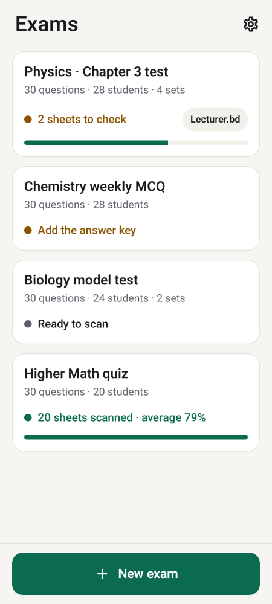
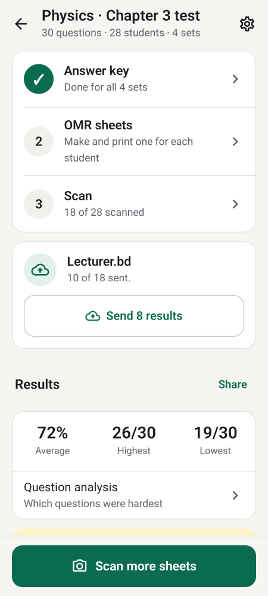
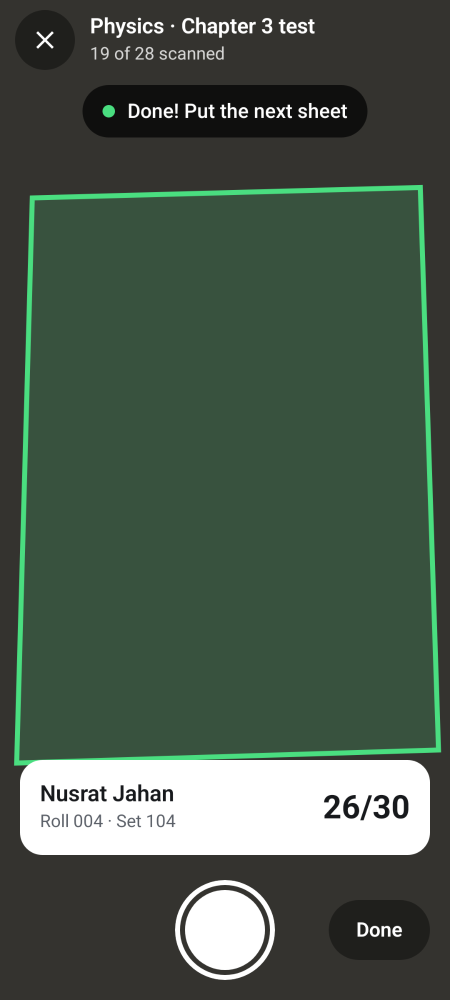
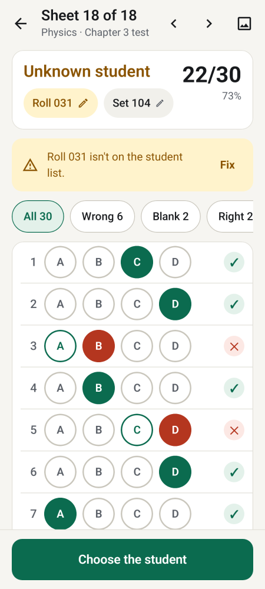
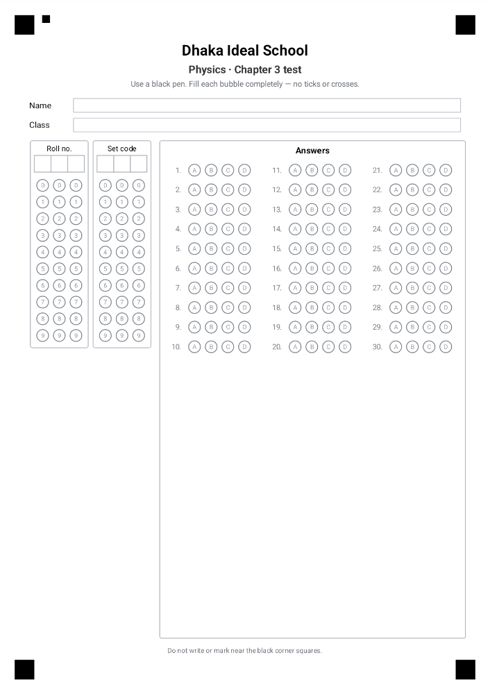
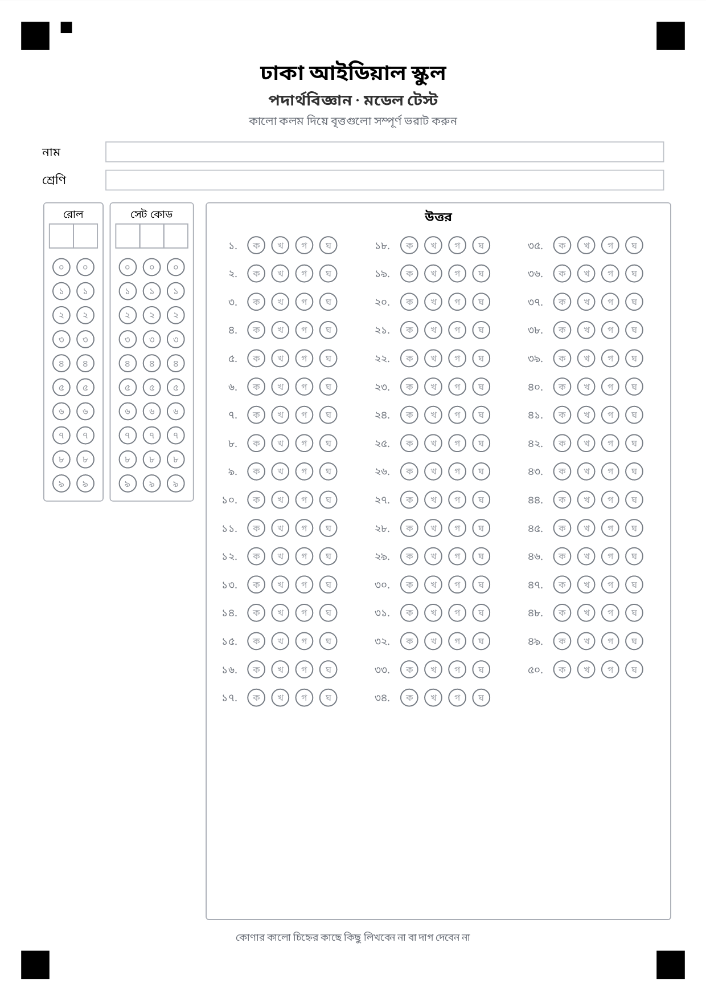
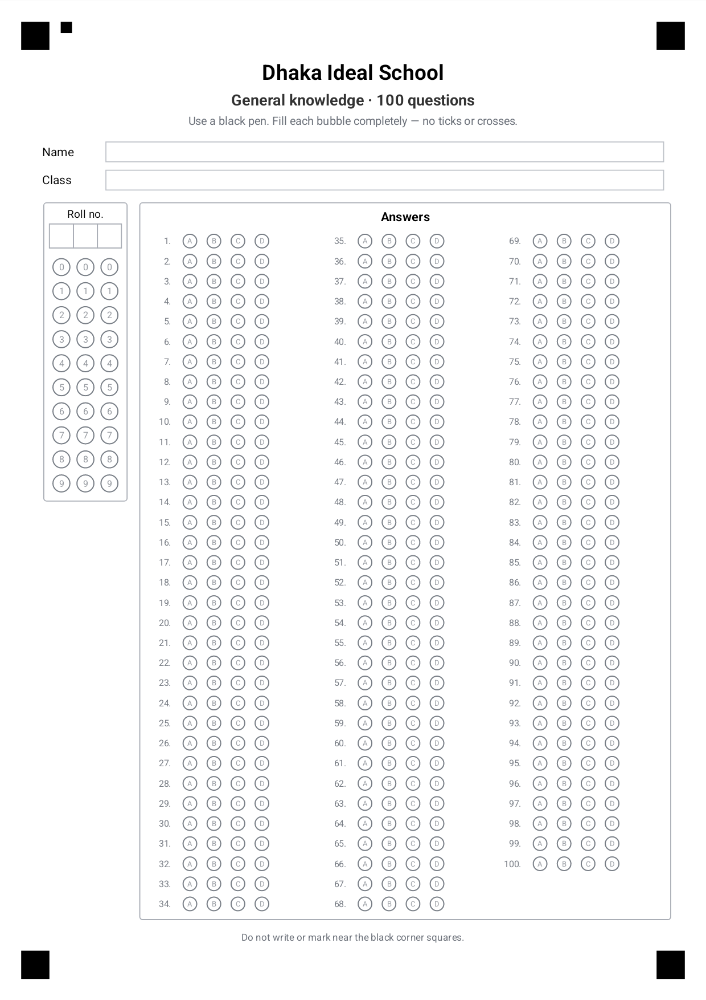

# OMR Scanner — Android app

A native Android app for teachers. Make an exam, print its OMR (bubble) answer sheets, then scan the filled sheets with the phone camera and get every student's marks. It works offline, and with [Lecturer.bd](https://lecturer-nine.vercel.app) it brings in your question papers and sends the results back. A document scanner for papers and ID cards is tucked into Settings.

Kotlin · Jetpack Compose (Material 3) · CameraX · OpenCV 4.10 · Google ML Kit Document Scanner · Room · Retrofit

---

## Build and run

**Requirements:** Android Studio Koala (2024.1) or newer, JDK 17 (bundled with Android Studio), and a phone running Android 8.0 (API 26) or newer, with Google Play services. The document scanner needs Play services.

1. Open Android Studio → **File → Open** → choose this `OMRScanner` folder.
2. Let Gradle sync. The first sync downloads Gradle 8.9 and all libraries, including OpenCV (~30 MB) and ML Kit.
3. Connect a phone with USB debugging on, then press **Run ▶**.

From the command line:

```bash
./gradlew assembleDebug          # → app/build/outputs/apk/debug/app-debug.apk
./gradlew installDebug           # install on a connected phone
./gradlew test                   # unit tests, and every screen drawn to a picture (below)
./gradlew recordPaparazziDebug   # redraw the screen pictures in app/src/test/snapshots/images
```

**No Android Studio? Let GitHub build it.** The workflow `.github/workflows/build-apk.yml` tests and builds a debug APK on every push to `main`: open the **Actions** tab → the latest **Build APK** run → download **OMRScanner-apk** under *Artifacts*. Signed releases come from a version tag (see [Releases](#releases)).

---

## How it works for the teacher

The app is built to be simple: no tabs, one exam at a time, and one big button at the bottom of each screen for the thing to do next.

1. **Home** lists the exams. Each card says in a few words how the exam stands ("Add the answer key", "3 sheets to check", "28 scanned · average 72%"). **New exam** is at the bottom; Settings is the gear.
2. **New exam** makes the exam and its OMR sheet together: a name, the number of questions (MCQ, up to 100), the choices per question (2 to 6) and their letters (A B C D, ক খ গ ঘ or 1 2 3 4; Bangla letters print the whole sheet in Bangla), the number of students and of question sets. A picture of the sheet follows every choice. Or pick **From Lecturer.bd** to bring in a final question paper with its keys and students; its questions and choices (4 each) are then the paper's.

   More questions, more choices or a longer roll number make the bubbles smaller. A sheet is refused only when they'd get too small to fill and scan well (under about 3.4 mm), and the app says how many questions do fit: for example 100 questions of 6 choices need the set code off, or at most 82 with it.
3. **An exam** is three numbered steps, ticked off as they're done, with the results under them:
   1. **Answer key**: tap the right answer for each question (one key per set; the chips at the top switch sets). Or fill every set from a question bank.
   2. **OMR sheets**: this is where the sheet is made. A picture of it, a few settings (questions, choices, language, roll digits, set code, name lines, school name), then **Print sheets** (Android's print dialog, which can also save a PDF) or **Share** (to send the PDF to a print shop). There's one A4 sheet per student, and the settings lock once sheets have been scanned, because the scanner reads by them.
   3. **Scan**: hold the phone over a sheet. It finds the four corner squares, reads the sheet by itself when steady (or press the round button), buzzes, shows the student's name and marks, then waits for the next sheet, so a stack goes quickly.
4. **Results** list every student with their marks. Sheets that need a look come first, with the reason ("Check roll", "Check set", "Same roll"): the sheet screen shows each answer (the right one ringed in green), lets you tap a bubble to fix a misread mark, choose the right student or set, see the photo, or delete the sheet. **Share** sends a CSV; **Question analysis** shows the hardest questions and the spread of marks.
5. **Exam settings** (the gear on an exam): its name and class, the students' names, what two answers on one question mean (counted wrong as in board exams, or your choice on each sheet), and deleting the exam.

How a sheet is marked: two firm marks on one question count as wrong by default; a much lighter second mark counts as rubbed out; a blank question gets 0.

### Screen pictures

| Home | An exam | Scanning | Checking a sheet |
|---|---|---|---|
|  |  |  |  |

`app/src/test/java/com/omrscanner/app/ScreensTest.kt` draws every screen with sample exams on a 360 × 800 dp phone ([Paparazzi](https://github.com/cashapp/paparazzi), no phone or emulator needed), and `SheetsTest.kt` draws the OMR sheet itself, exactly as it prints:

| English, 30 questions | Bangla, 50 questions | 100 questions |
|---|---|---|
|  |  |  |

`gradlew recordPaparazziDebug` writes the pictures to `app/src/test/snapshots/images`; the normal test run draws them too, so a screen that can't be drawn fails the build.

### Document scanner (Settings → Scan documents)
- **Scan document** opens Google's ML Kit scanner: live edge detection, auto-capture, crop handles, perspective correction and background removal, on-device.
- **Scan ID card** captures the front and then the back, and puts both on **one A4 page at true card size** (85.6 × 54 mm), so a printout works as a photocopy.
- **Document editor:** rename, add pages, add an ID card, reorder pages with ‹ ›, reverse the order, delete.
- **Page editor:** Original / Enhanced / Grayscale / B & W (OpenCV adaptive threshold) filters, rotate, delete.
- **Export PDF:** page size (A4, Letter, Fit to scan), quality, page numbers. Then **Share**, or **Save** to `Downloads/OMR Scanner`.

### Settings
The Lecturer.bd account, the school name printed on new sheets, and whether scanning takes the photo by itself. Under **Advanced**: the steepest angle a photo may be taken at (default 25°), how much lighter a mark must be to count as rubbed out (default 55%), and your own question-bank server.

---

## How OMR reading works

```
camera frame ─▶ grayscale ─▶ adaptive threshold ─▶ all contours
            ─▶ keep solid squares (fill of rotated box ≥ 0.86 — bubbles are circles at ≈0.79)
            ─▶ the 4 similar squares forming the largest quad = corner markers
            ─▶ small square nearest a marker = top-left (handles 90°/180°/270°)
            ─▶ perspective transform to the 1000 × 1414 sheet space
            ─▶ divide by blurred copy (removes shadows)
            ─▶ sample each bubble at its printed position
            ─▶ darkness relative to the row's emptiest bubble:
                 none ≥ 0.28 → blank · one → answer
                 two → lighter < erase ratio × darker ? erased (ignored) : double
```

`omr/SheetLayout.kt` is the single source of truth for where every bubble is. **The same object prints the sheet (`SheetPdf`) and reads it (`OmrReader`)**, so they cannot drift apart.

### Tuning
`tools/omr_simulation.py` is a line-by-line Python port of the detector and reader. It renders a filled sheet, photographs it synthetically (tilt, turn, upside down, shadow, noise) and checks every mark:

```bash
pip install opencv-python-headless numpy
python3 tools/omr_simulation.py
```

All 7 scenarios read perfectly with the shipped thresholds. Change `FILLED`, `PRESENT` or the detector filters there first, then copy the change to `OmrDetector.kt` / `OmrReader.kt`.

### Printing tips
- Print at **100 % / actual size** on A4 with a laser printer. Don't use "fit to page".
- Keep the four black corner squares and the small square next to the top-left one clear of writing.
- Students should fill bubbles fully with a black or dark-blue pen.

---

## Question bank API

Answer keys can be filled from a question bank: your Lecturer.bd papers when signed in there, or your own server, set in **Settings → Advanced → Question bank server**, which implements:

```
GET {url}/papers?q=physics
→ [ { "id": "qb1", "title": "Physics · Unit 3", "code": "QB-PHY-0311", "subject": "Physics",
      "questions": 30, "options": 4, "setCount": 320, "firstSet": "101", "lastSet": "420",
      "author": "Md. Rahman", "updated": "Nov 5, 10:42 AM" } ]

GET {url}/papers/{id}
→ { "id": "qb1", "title": "…", "code": "QB-PHY-0311", "questions": 30, "options": 4,
    "sets": { "101": [2,0,3,1,…], "102": [1,1,0,3,…], … } }      // option index per question, 0 = A
```

The client lives in `data/bank/QuestionBank.kt` (`RemoteQuestionBank`).

---

## Lecturer.bd

Teachers on [Lecturer.bd](https://lecturer-nine.vercel.app) make their question papers there (sets shuffled from their question bank) and use this app to scan the answer sheets.

1. **Settings** (the gear on Home) **→ Lecturer.bd**: sign in with the same mobile number and password as on the website. The session token is kept in its own preferences file, left out of backups (`res/xml/backup_rules.xml`, `data_extraction_rules.xml`). While signed in, the question bank is the teacher's final Lecturer.bd papers.
2. **New exam → From Lecturer.bd**: pick a final paper. The exam comes set up: the answer sheet as Lecturer.bd lays it out (Bangla labels, roll digits, set-code grid), the students by roll, and every set's key. Picking the same paper again opens that exam.
3. Print the sheets, scan them, check the unclear ones.
4. **Send results** on the exam's page sends the checked sheets Lecturer.bd doesn't have yet. Lecturer.bd marks each one again itself against its set's key (with its own negative marking) and answers sheet by sheet; refused ones (an unreadable roll, a set code not on the paper) are listed. A sheet changed afterwards is sent again with the next upload.

The API (Lecturer.bd's `src/server/omr-api.ts`), always with `Authorization: Bearer <token>` after signing in:

```
POST /api/omr/login              { identifier, password }  → { token, teacher: { name, handle } }
POST /api/omr/logout             → 204
GET  /api/omr/papers?q=          → [PaperSummary]          (final papers with MCQs)
GET  /api/omr/papers/{id}        → Paper + layout { labels, language, rollDigits, setCode, institution, examName }
                                          + students [{ roll, name }]   (rolls padded to rollDigits)
POST /api/omr/papers/{id}/results { sheets: [{ roll, setCode, marks, scannedAt }] }   (marks in MarkCodec form)
                                 → { saved, sheets: [{ roll, ok, name, score, total } | { roll, ok: false, error }] }
```

The client is `data/lecturer/LecturerApi.kt`. Database version 2 adds `exams.remotePaperId` and `sheets.uploadedAt` (migration in `AppDatabase.kt`).

## Releases

`.github/workflows/release.yml` builds a signed release APK on a version tag (`git tag v1.1.0 && git push origin v1.1.0`) and attaches it to a GitHub Release as `omr-scanner.apk`, so `https://github.com/maannnaan/OMR/releases/latest/download/omr-scanner.apk` is always the newest. Every release must be signed with the same key, or phones refuse the update. The workflow takes it from four repository secrets: `OMR_KEYSTORE_BASE64`, `OMR_KEYSTORE_PASSWORD`, `OMR_KEY_ALIAS`, `OMR_KEY_PASSWORD`. To build a signed release locally, put a `keystore.properties` (`storeFile`, `storePassword`, `keyAlias`, `keyPassword`; ignored by git) beside this README and run `gradlew assembleRelease`. Release builds carry only the phones' native libraries (arm64-v8a, armeabi-v7a).

---

## Project structure

```
app/src/main/java/com/omrscanner/app/
├── OmrApp.kt                 Application: OpenCV init, dependency container, first-run demo exam
├── MainActivity.kt
├── omr/                      ── the OMR engine ──
│   ├── Model.kt              Layout, Mark, MarkCodec, KeyCodec, Grading
│   ├── SheetLayout.kt        geometry of the printed sheet (shared by printing and reading)
│   ├── SheetPdf.kt           printable A4 sheets + preview
│   ├── OmrDetector.kt        corner markers, orientation, tilt
│   ├── OmrReader.kt          perspective correction + bubble reading
│   └── FrameUtils.kt         CameraX frame → OpenCV Mat
├── docs/                     ── document scanner ──
│   ├── ImageOps.kt           filters, rotation, ID card page
│   └── PdfExporter.kt        multi-page PDF
├── data/
│   ├── db/                   Room entities, DAOs, database
│   ├── bank/QuestionBank.kt  remote API + sample bank
│   ├── lecturer/LecturerApi.kt  Lecturer.bd: sign-in, papers, result upload
│   ├── ExamBundle.kt         grading questions the screens ask
│   ├── Repositories.kt       exams, sheets, keys, documents, CSV export
│   ├── FileStore.kt          storage, share, save to Downloads
│   └── AppSettings.kt
└── ui/
    ├── AppRoot.kt            navigation, no tabs: Home → an exam → its steps; Settings behind the gear
    ├── AppViewModel.kt
    ├── components/Common.kt  the few pieces every screen is built from (screen, card, step, setting row, dialogs…)
    ├── theme/Theme.kt        Lecturer.bd's palette: white cards, warm grey page, one green
    ├── exams/                home, new exam, exam, exam settings, students, answer key, answer sheets, sheet check, analysis, Lecturer.bd papers
    ├── scan/OmrScanScreen.kt camera + live detection
    ├── docs/                 documents, ML Kit launcher, editor, page editor, export
    └── settings/             settings
tools/omr_simulation.py       algorithm test bench (Python + OpenCV)
```

## Data and privacy
Everything is stored on the phone: a Room database plus image files under the app's private storage. Nothing leaves the device unless you share or export a file, connect a question-bank server, or upload results to Lecturer.bd (then only each sheet's roll, set code, marks and scan time; never the photos).
